# ShelfLend: library lending, shipped the DevSecOps way

**Parth Agarwal · Roll No. 10293 · Session 21 Final Capstone**

ShelfLend is the front desk of a small library: a catalogue of books and physical copies, a member
register, and a loan workflow with real rules (one active loan per copy, member loan limits, overdue
fines, capped renewals). Around it sits a full delivery platform: tests, non-root containers, a
GitHub Actions pipeline with Trivy/Gitleaks/Bandit gates and SHA-tagged GHCR images, Terraform for
an AWS VPC + EKS, a Helm chart deployed by Argo CD (GitOps) onto Kubernetes, and Prometheus/Grafana
with HTTP and business metrics.

| | |
|---|---|
| 🎬 **Demo video** | [demo/ShelfLend-demo.mp4](demo/ShelfLend-demo.mp4) (12 min 41 s, no audio; captions on screen) |
| 📊 **Slides** | [demo/ShelfLend-presentation.pptx](demo/ShelfLend-presentation.pptx) · [PDF](demo/ShelfLend-presentation.pdf) (14 slides) |
| ✅ **Green pipeline run** | [actions/runs/39137097931](https://github.com/Jadooonum1/devsecops-python/actions/runs/39137097931) (the push recorded in the video) |
| 📦 **Images (GHCR)** | [shelflend-backend](https://github.com/Jadooonum1/devsecops-python/pkgs/container/shelflend-backend) · [shelflend-frontend](https://github.com/Jadooonum1/devsecops-python/pkgs/container/shelflend-frontend) |

| Layer | What is used |
|---|---|
| Frontend | React 18 + Vite 6, served by `nginx-unprivileged` (UID 101) |
| Backend | FastAPI 0.142 on Python 3.12, SQLAlchemy 2.0, Alembic 1.20 (UID 10001) |
| Database | PostgreSQL 17 (StatefulSet + PVC in Kubernetes) |
| Tests | pytest 9: 32 tests, 92% coverage, SQLite test DB built by the real migrations |
| CI/CD | GitHub Actions, 11 jobs, GHCR images tagged with the full commit SHA (amd64 + arm64) |
| Security | Trivy 0.75 (HIGH/CRITICAL gate on both images and both platforms), Gitleaks 8.30, Bandit 1.9, npm audit |
| Kubernetes | kind 0.33, Helm 4 chart, ingress-nginx 1.15, HPA 2–6, PDBs, restricted Pod Security |
| GitOps | Argo CD 3.5, auto-sync with prune + self-heal |
| Observability | kube-prometheus-stack 92.8 (Prometheus, Alertmanager, Grafana), ServiceMonitor, 4 alert rules, 12-panel dashboard |
| Infrastructure | Terraform 1.16.6, AWS provider 6.x: VPC, 2 public + 2 private subnets, NAT, EKS + managed node group |

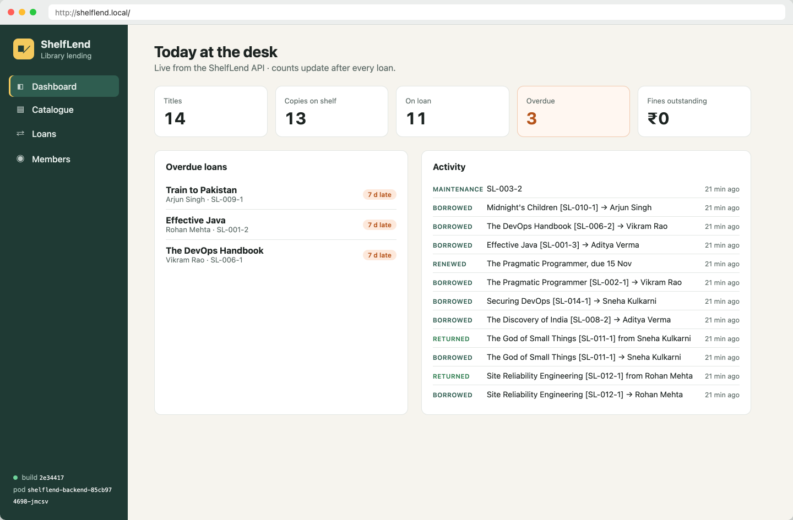

## Contents

1. [What the app does](#1-what-the-app-does)
2. [Architecture](#2-architecture)
3. [Tech stack](#3-tech-stack)
4. [Repository structure](#4-repository-structure)
5. [Run it locally](#5-run-it-locally-docker-compose)
6. [M1: Application](#m1-application)
7. [M2: Testing](#m2-testing)
8. [M3: Git and GitHub](#m3-git-and-github)
9. [M4: Docker](#m4-docker)
10. [M5: CI/CD pipeline](#m5-cicd-pipeline)
11. [M6: DevSecOps](#m6-devsecops)
12. [M7: Terraform](#m7-terraform)
13. [M8: Kubernetes + Helm + Argo CD](#m8-kubernetes--helm--argo-cd)
14. [M9: Observability](#m9-observability)
15. [Troubleshooting labs](#troubleshooting-labs)
16. [Engineering findings](#engineering-findings)
17. [Known issues and limitations](#known-issues-and-limitations)
18. [M10: Presentation and demo](#m10-presentation-and-demo)
19. [Submission checklist](#submission-checklist)

---

## 1. What the app does

A librarian adds **books** (validated, normalised ISBNs) and their physical **copies** (barcodes, shelf),
registers **members**, and lends copies out. The rules are enforced at three levels, in the API (`409`
with a readable reason), by row locks, and by the database itself:

| Rule | How it is enforced |
|---|---|
| A copy can't be on two active loans | API check + `SELECT … FOR UPDATE` on member and copy + partial unique index `uq_loans_one_active_per_copy` |
| Members have a loan limit (default 3) | counted under the member row lock → `409 "Asha Rao already has 2 of 2 loans"` |
| Overdue loans earn fines (₹10/day) | computed on return; ₹100 unpaid blocks new loans until settled |
| Renewals capped at 2 × 14 days | refused when overdue or at the cap (`409`) |
| Closed loans can't change | return/renew/lost on a non-active loan → `409` |
| Books/members with loan history can't be deleted | `409`; copies can go to maintenance instead |
| Every change is audited | `audit_events` table → dashboard activity feed |

The lending rules are published by `GET /api/info`, so the UI never hardcodes them.

### Endpoints

| Method | Path | Purpose |
|---|---|---|
| GET | `/health` | liveness, never touches the DB |
| GET | `/ready` | readiness: DB reachable **and** schema migrated (`503` otherwise) |
| GET | `/metrics` | Prometheus metrics (HTTP + business gauges) |
| GET | `/api/info` | build SHA, pod name, lending rules |
| GET, POST | `/api/books` | list/search, create |
| GET, PUT, DELETE | `/api/books/{id}` | read, update, delete |
| POST | `/api/books/{id}/copies` | add a physical copy |
| GET | `/api/copies?status=&book_id=` | list copies |
| PATCH | `/api/copies/{id}` | available ↔ maintenance |
| GET, POST | `/api/members` | list, create |
| PUT, DELETE | `/api/members/{id}` | update, delete |
| GET, POST | `/api/loans?status=active\|overdue\|returned\|lost` | list, borrow |
| POST | `/api/loans/{id}/return` · `/renew` · `/lost` · `/pay` | loan state machine |
| GET | `/api/stats`, `/api/activity` | dashboard tiles and feed |

Interactive docs: `/docs` (Swagger UI), exposed through the Ingress.

## 2. Architecture

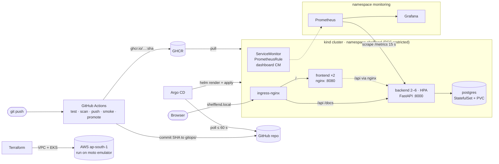

**Request path:** browser → ingress-nginx → `/` to the frontend Service, `/api`, `/docs` and
`/openapi.json` to the backend Service → Postgres. **Delivery path:** push → Actions builds, scans and
pushes images tagged with the commit SHA → the `promote` job commits that SHA into
`gitops/values-gitops.yaml` → Argo CD notices the commit and rolls it out.

## 3. Tech stack

| Area | Tool | Version | Why |
|---|---|---|---|
| Language | Python | 3.12 | backend |
| API | FastAPI / Starlette | 0.142.2 / 1.7.0 | typed API, OpenAPI docs |
| ORM / migrations | SQLAlchemy / Alembic | 2.0.49 / 1.20.0 | models, CHECK constraints, migrations |
| DB driver | psycopg | 3.3.6 | Postgres |
| Metrics | prometheus-fastapi-instrumentator / prometheus-client | 8.1.0 / 0.26.0 | `/metrics` |
| UI | React / Vite | 18.3 / 6.3 | SPA, relative `/api` calls |
| Tests | pytest / pytest-cov / httpx | 9.1.1 / 7.1.0 / 0.28.1 | API tests |
| Containers | Docker (Colima) / Compose | 29.5 / 5.6 | local stack |
| Base images | `python:3.12-slim`, `node:22-alpine`, `nginxinc/nginx-unprivileged:1.29-alpine`, `postgres:17-alpine` | | |
| CI | GitHub Actions (`ubuntu-24.04`), buildx + QEMU, skopeo | | multi-arch build, push the scanned archive |
| Security | Trivy / Gitleaks / Bandit | 0.75.0 / 8.30.1 / 1.9.4 | image CVEs, secrets, Python SAST |
| Kubernetes | kind / kubectl / Helm | 0.33 / 1.37 / 4.3 | local cluster, packaging |
| Ingress | ingress-nginx | controller-v1.15.1 | `/` and `/api` routing |
| GitOps | Argo CD (argo-cd chart) | v3.5.5 (10.10.5) | auto-sync from Git |
| Monitoring | kube-prometheus-stack | 92.8.0 | Prometheus, Grafana, Alertmanager |
| IaC | Terraform / AWS provider | 1.16.6 / ~> 6.0 | VPC + EKS |
| AWS emulator | moto | 5.1.22 | Terraform apply/destroy without an AWS account |

## 4. Repository structure

```text
.
├── backend/                  FastAPI app
│   ├── app/                  config, db, models, schemas, main (routes), metrics, wait_for_db
│   ├── alembic/              env.py (advisory lock) + versions/0001, 0002
│   ├── tests/                conftest.py (SQLite + real migrations), test_api.py (32 tests)
│   ├── Dockerfile            multi-stage, no pip in runtime, UID 10001
│   └── docker-entrypoint.sh  wait for DB → alembic upgrade head → uvicorn
├── frontend/                 React + Vite; Dockerfile (node build → nginx-unprivileged), nginx/ template
├── docker-compose.yml        postgres → backend (/ready) → frontend on :3000
├── .github/workflows/ci-cd.yml
├── security/                 trivy.yaml, .gitleaks.toml, bandit.yaml
├── helm/shelflend/           Chart.yaml, values{,-dev,-staging,-prod}.yaml, templates/, dashboards/
├── k8s/                      namespace.yaml, kind-cluster.yaml, migration-race-job.yaml
├── gitops/                   argocd-application.yaml, argocd-values.yaml, values-gitops.yaml (CI writes the SHA)
├── monitoring/               kube-prometheus-stack-values.yaml
├── terraform/                versions/variables/main/outputs.tf, tfvars.example, lock file, emulator/run.sh
├── troubleshooting/          three broken-deployment labs
├── scripts/                  seed.py, backdate-loans.sql, load-test.sh
├── screenshots/  evidence/   PNG evidence and the raw text output it was rendered from
├── demo/                     video + slides
└── docs/course-README.md     the original course README
```

## 5. Run it locally (Docker Compose)

```bash
git clone https://github.com/Jadooonum1/devsecops-python.git && cd devsecops-python
cp .env.example .env              # optional: override the local-only DB password
docker compose up --build         # postgres → backend → frontend
python3 scripts/seed.py           # optional demo data (stdlib only)
```

* App: <http://localhost:3000> · API docs: <http://localhost:8000/docs>
* Backend tests: `cd backend && python3.12 -m venv .venv && .venv/bin/pip install -r requirements-dev.txt && .venv/bin/python -m pytest -v`
* Frontend dev server: `cd frontend && npm ci && npm run dev` (proxies `/api` to `:8000`)

---

## M1: Application

* **Backend** ([backend/app/main.py](backend/app/main.py)): 23 routes plus `/metrics`, using GET/POST/PUT/PATCH/DELETE; every
  write returns what the DB stored (`db.refresh`).
* **Database**: 5 tables from two Alembic migrations ([0001](backend/alembic/versions/0001_catalogue_and_members.py),
  [0002](backend/alembic/versions/0002_loans_and_audit.py)) with CHECK constraints and the partial unique index.
* **Frontend** ([frontend/src](frontend/src)): dashboard, catalogue (books + copies), loans (lend, return, renew,
  lost, settle fine), members. Loading/error states and a toast for every 409. Below 760 px the sidebar
  becomes a top bar and table rows become cards.

| Dashboard | Loans |
|---|---|
|  | 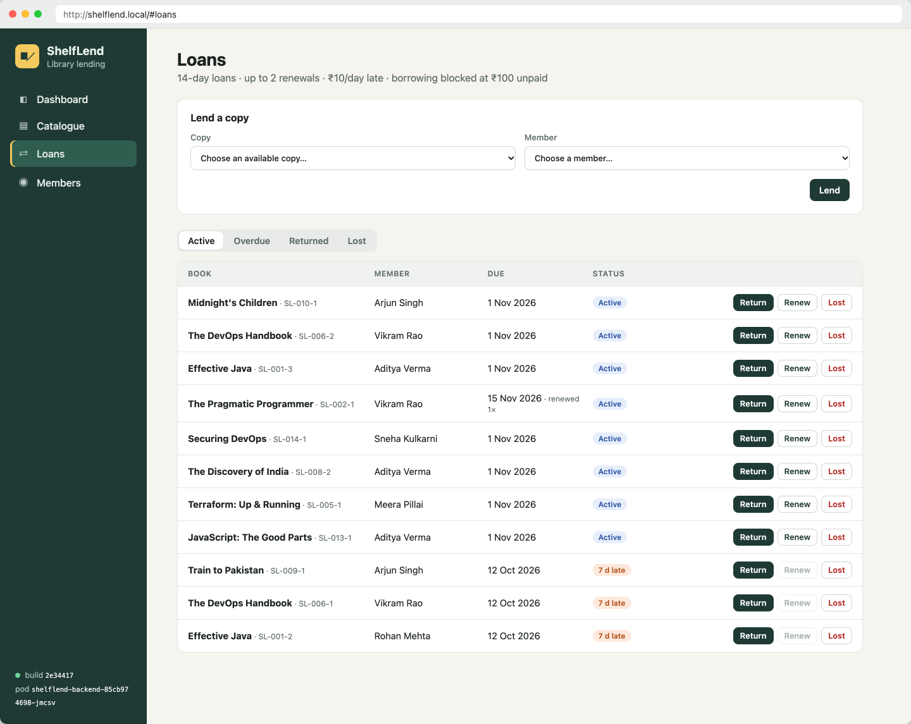 |
| **Catalogue with copies expanded** | **Members** |
| 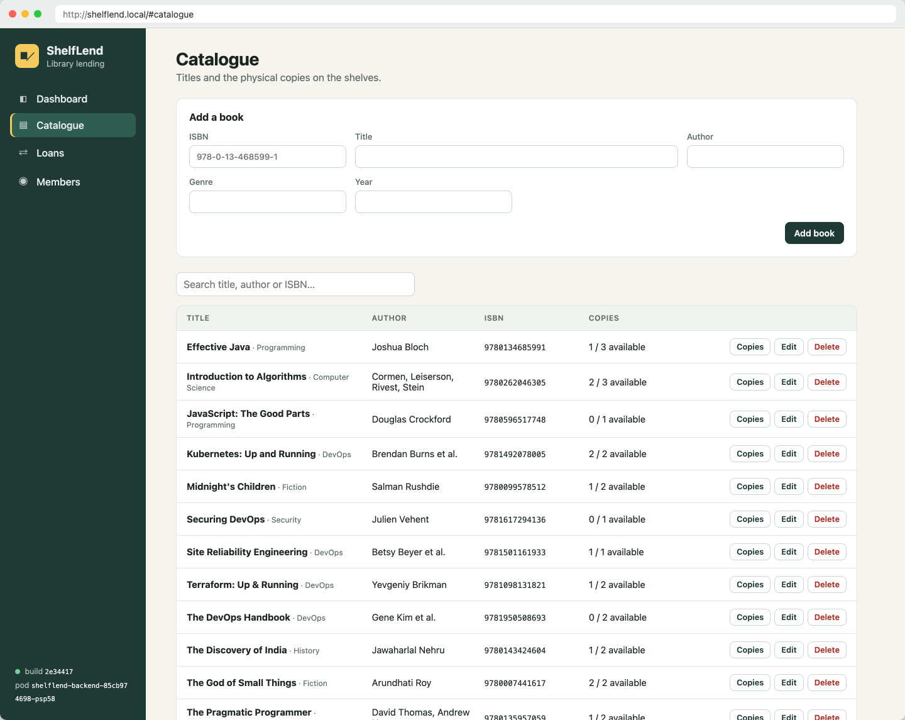 | 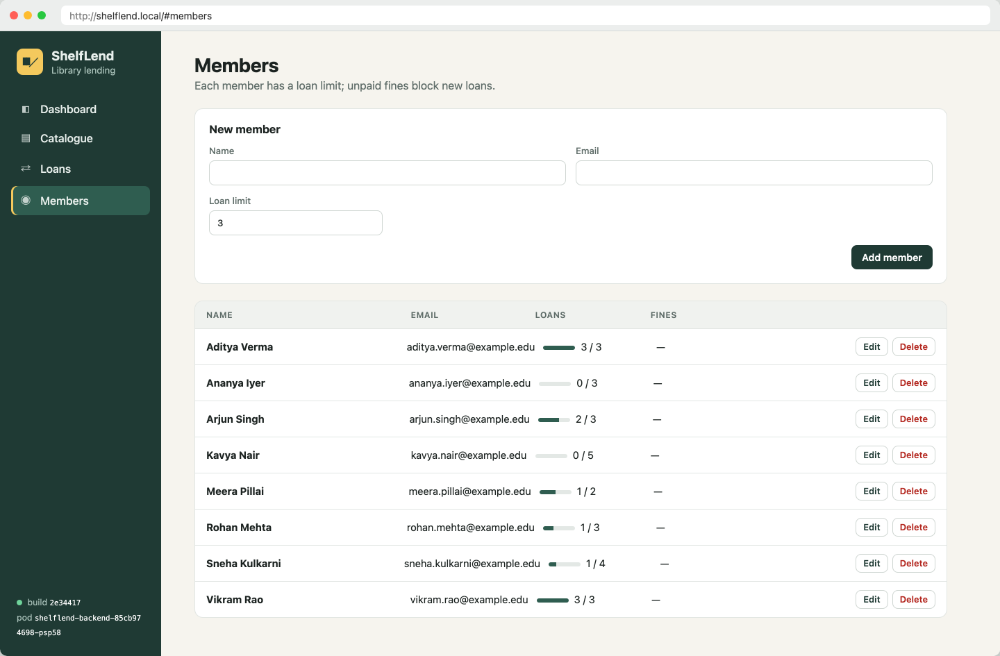 |

| Phone width (390 px) | Swagger `/docs` via the Ingress |
|---|---|
| 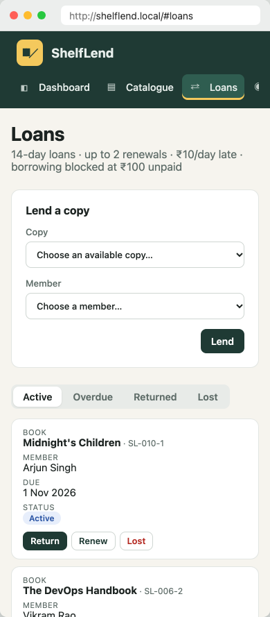 | 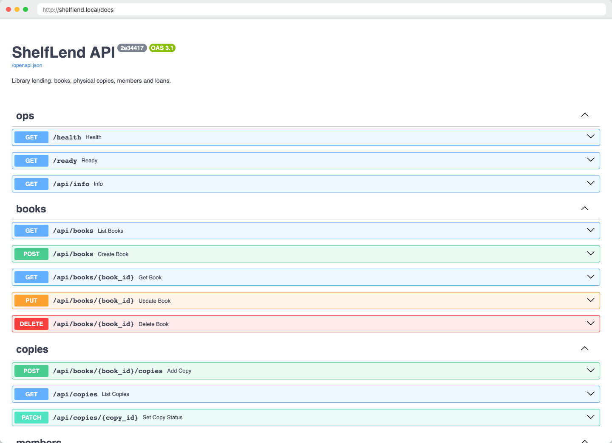 |

## M2: Testing

* [backend/tests/conftest.py](backend/tests/conftest.py) points `DATABASE_URL` at a **temporary SQLite file
  before the app is imported**, then builds the schema with the **real Alembic migrations** (so they are
  tested too). Every test starts from empty tables. Postgres is never touched.
* [backend/tests/test_api.py](backend/tests/test_api.py): **32 tests** over health/ready/info, books, copies,
  members, loans, stats, activity and `/metrics`: happy paths, 404, 409 (duplicate ISBN/barcode/email,
  copy on loan, loan limit, fine block, renew cap, closed loans), 422 validation, fines after a
  backdated due date, and a raw `INSERT` that the partial unique index must refuse.
* [backend/pytest.ini](backend/pytest.ini) configures discovery and warnings.

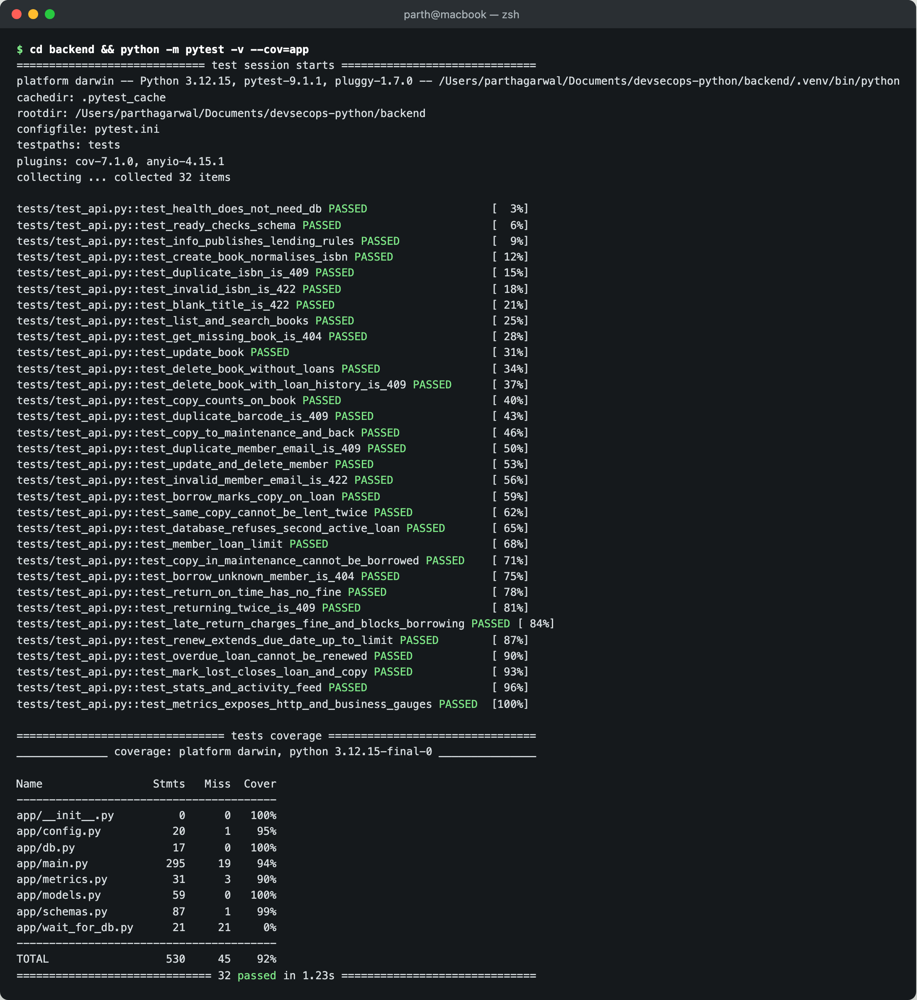

## M3: Git and GitHub

* Public fork: <https://github.com/Jadooonum1/devsecops-python>, with commits in `area: what and why` style
  (`backend: loan workflow API with 409s for illegal transitions`, `ci: publish amd64+arm64 images and scan every platform`, …).
* [.gitignore](.gitignore) excludes `.env`, `__pycache__/`, `node_modules/`, `.venv/`, Terraform state/plans/`*.tfvars`.
* The pipeline's `promote` commits are authored with the same identity.

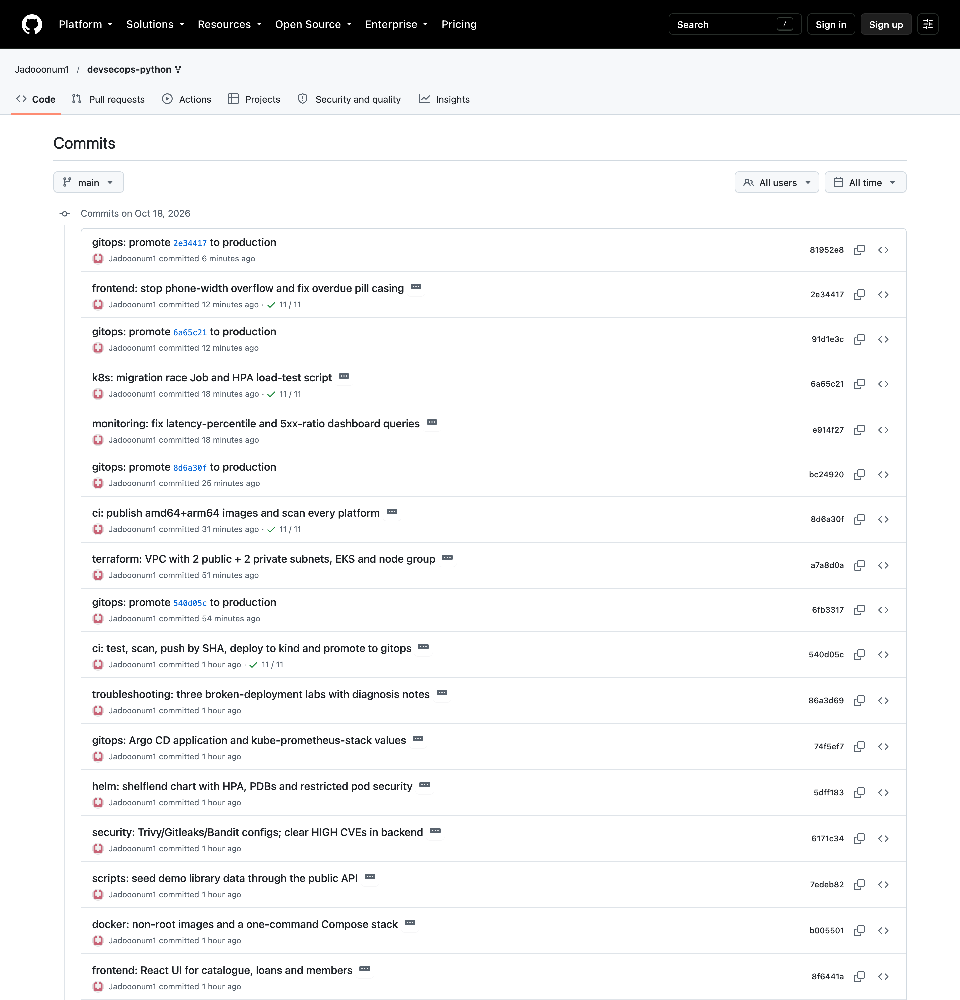

## M4: Docker

* [backend/Dockerfile](backend/Dockerfile): two stages. Dependencies go into `/opt/venv`, then the runtime copies the
  venv, removes the system pip/setuptools, and runs as **UID 10001**. Entrypoint: wait for Postgres → `alembic upgrade head` → uvicorn.
* [frontend/Dockerfile](frontend/Dockerfile): **multi-stage**. `node:22-alpine` builds the bundle (on the build
  platform), then `nginx-unprivileged:1.29-alpine` serves it as **UID 101** on 8080, with unused nginx modules removed.
  `BACKEND_URL` is rendered into the nginx template at start.
* [docker-compose.yml](docker-compose.yml): `postgres` (pg_isready) → `backend` (healthcheck on `/ready`) →
  `frontend` on `localhost:3000`.

| `docker compose up --build` | CRUD through nginx, `\dt`, and `id` in both containers |
|---|---|
| 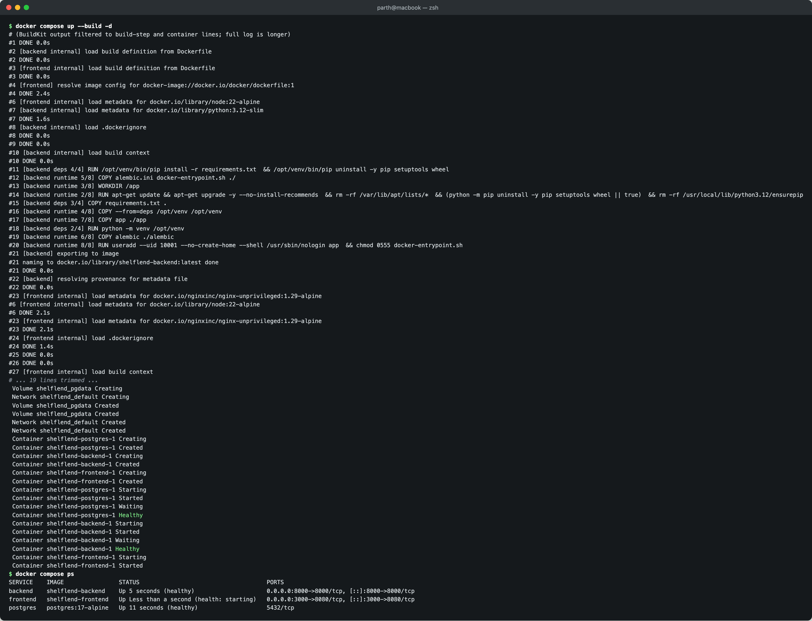 | 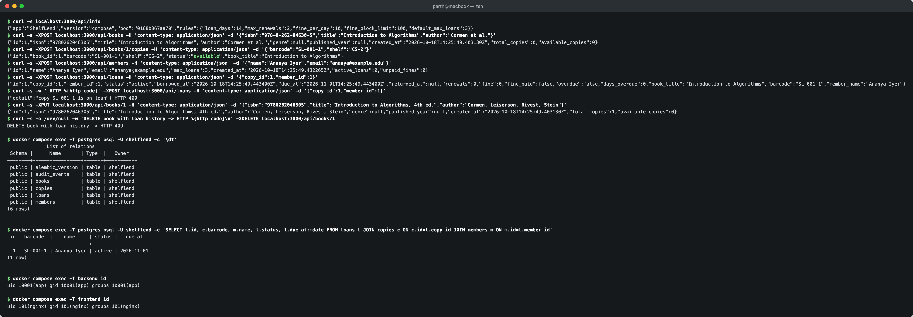 |

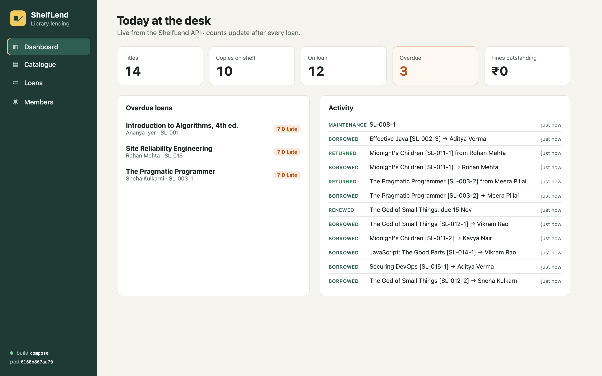

## M5: CI/CD pipeline

[.github/workflows/ci-cd.yml](.github/workflows/ci-cd.yml) runs on every push to `main` (and on PRs, which stop before pushing):

| Job | What it proves |
|---|---|
| Backend tests (pytest) | 32 tests; **any failure fails the build** and blocks every image job |
| Migrations on real Postgres | `upgrade → downgrade base → upgrade`, then **3 concurrent `alembic upgrade head`**; asserts exactly one applied `0001` |
| Frontend build | `npm ci`, `npm run build`, `npm audit --omit=dev --audit-level=high` |
| Secrets + SAST | Gitleaks over the **full history**, Bandit `-ll` |
| Helm lint + render | every values file, plus a check that the chart refuses to render without an image tag |
| Build + Trivy (×2) | `buildx` **linux/amd64 + linux/arm64** into one OCI archive; each platform extracted with skopeo and **Trivy-gated** |
| Push to GHCR (×2) | the **same scanned archive** pushed as `ghcr.io/jadooonum1/shelflend-<component>:<full commit SHA>` (no `latest`) |
| Deploy to kind + smoke test | `helm upgrade --install --wait` from GHCR, then `/api/info` must report this SHA, a create returns 201 and the duplicate 409 |
| Promote SHA to gitops/ | writes the SHA into `gitops/values-gitops.yaml` and pushes; that path is `paths-ignore`d so it can't loop |

Permissions are `contents: read` by default; only push gets `packages: write` and only promote gets `contents: write`.

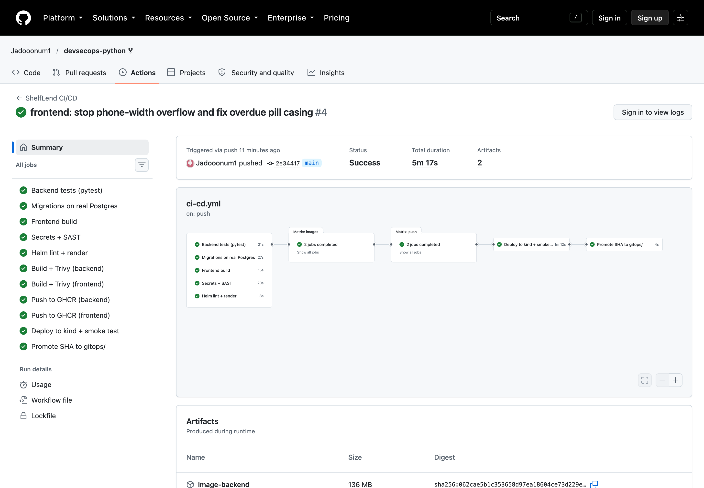

| GHCR backend: SHA tags | GHCR frontend: SHA tags |
|---|---|
|  | 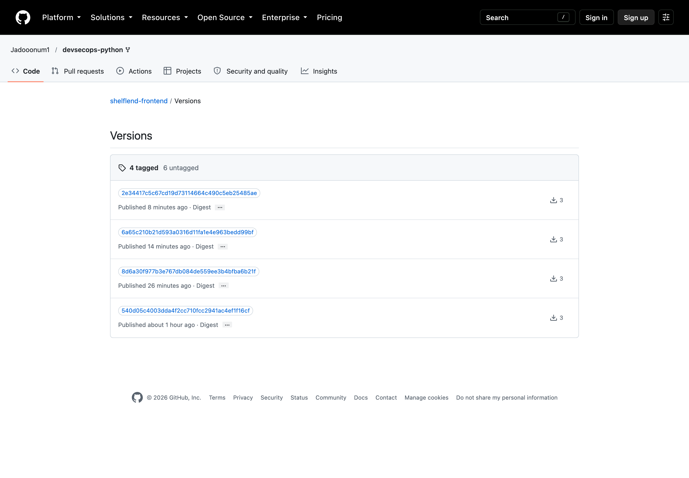 |

## M6: DevSecOps

[security/trivy.yaml](security/trivy.yaml): `severity: HIGH,CRITICAL`, `exit-code: 1`, vuln + secret scanners,
and `ignore-unfixed` under `vulnerability:` (at the top level Trivy silently ignores it).

**What Trivy scanned and what it found.** Trivy scans the OS packages and every Python/Node package
inside both images, for both CPU architectures. The **first backend image failed the gate with 7 HIGH
findings**. The key one was **CVE-2025-62727 in Starlette 0.48.0**: a request with a crafted `Range` header
containing many overlapping ranges made Starlette's range-merging use excessive CPU, a denial of service
against any `FileResponse`/static route; it is fixed in 0.49.1. The other six were two more Starlette
advisories, setuptools CVE-2025-47273, and urllib3 (CVE-2026-97687/97689) plus msgpack
(GHSA-6v7p-g79w-8964), both vendored inside pip. The fix was to upgrade FastAPI/Starlette and make the backend
Dockerfile multi-stage so the runtime image contains no pip or setuptools at all. **Every scan since is clean
(0 HIGH/CRITICAL) on both images and both platforms.**

| Before the fix: gate blocks (exit 1) | After the fix: gate passes (exit 0) |
|---|---|
| 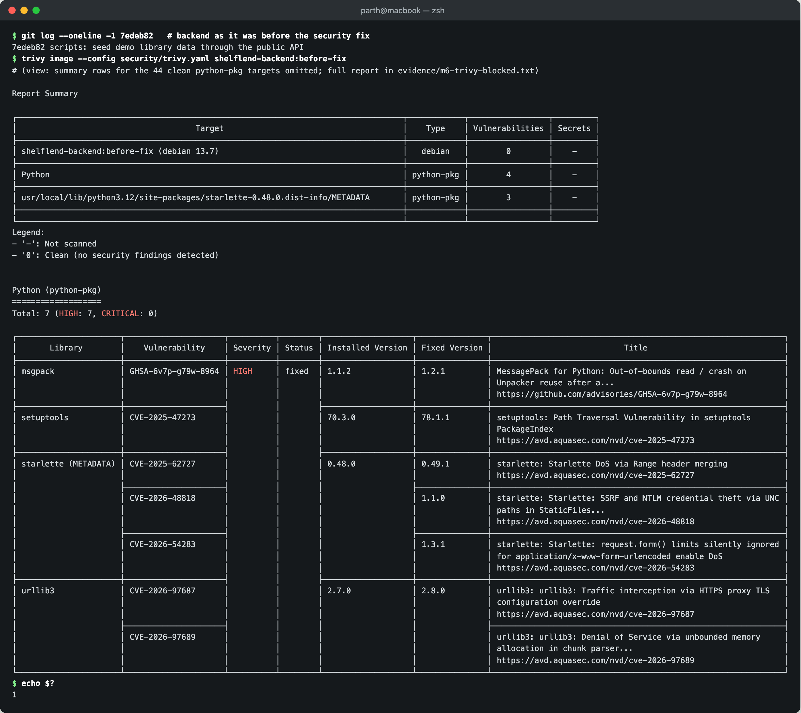 | 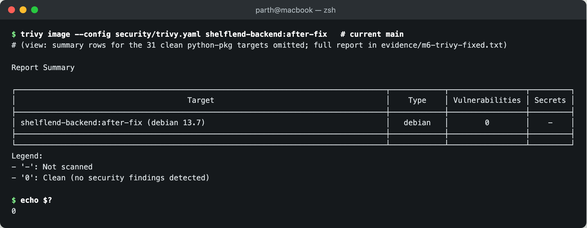 |

Trivy step from CI run 39137097931 (logs pulled with `gh run view --job <id> --log`, since run logs need a GitHub login):


Also in the pipeline: Gitleaks with [security/.gitleaks.toml](security/.gitleaks.toml) (default rules,
allowlist only for the documented local-only Compose password) and Bandit with [security/bandit.yaml](security/bandit.yaml).

## M7: Terraform

[terraform/](terraform/) uses plain `aws_*` resources (no community modules), so every object is visible in
[main.tf](terraform/main.tf). The plan has **22 resources**:

* `aws_vpc` 10.40.0.0/16 with DNS hostnames · **2 public subnets** (ap-south-1a/b, public IPs, `kubernetes.io/role/elb`) ·
  2 private subnets (`role/internal-elb`) · IGW · EIP + NAT gateway (optional via `enable_nat_gateway`) ·
  public/private route tables + 4 associations
* IAM: cluster role (`AmazonEKSClusterPolicy`) and node role (worker, CNI, ECR read-only)
* `aws_eks_cluster` 1.34 (API auth mode, creator gets admin) and **`aws_eks_node_group`** (2 × t3.medium, min 1, max 3, private subnets)
* [terraform.tfvars.example](terraform/terraform.tfvars.example) is committed; `*.tfvars`, state and plans are git-ignored;
  [.terraform.lock.hcl](terraform/.terraform.lock.hcl) is locked for linux_amd64 and darwin_arm64. No credentials anywhere.

> **⚠️ How this was run.** I don't have a personal AWS account, so `init → plan → apply → destroy` ran against
> the **moto AWS emulator** using [terraform/emulator/run.sh](terraform/emulator/run.sh). The `.tf` files are
> unchanged; a git-ignored `emulator_override.tf` points the provider's EC2/EKS/IAM/STS endpoints at
> `127.0.0.1:5050`. There are therefore **no AWS Console screenshots**. Instead, the AWS CLI was run against the same
> API to show the VPC, subnets, NAT and EKS cluster/node group. On a real account the same code runs with
> `AWS_PROFILE=<profile> terraform plan/apply/destroy` (about 15 min and roughly $0.30–0.50 for one apply → destroy cycle).

| `terraform plan`: 22 to add | `terraform apply` + outputs |
|---|---|
| 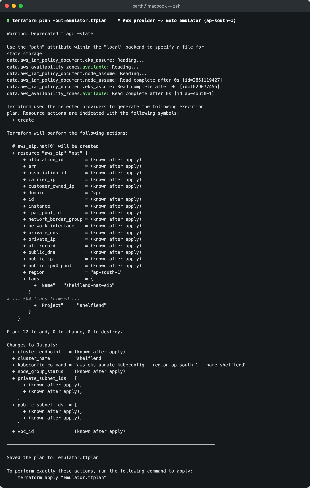 | 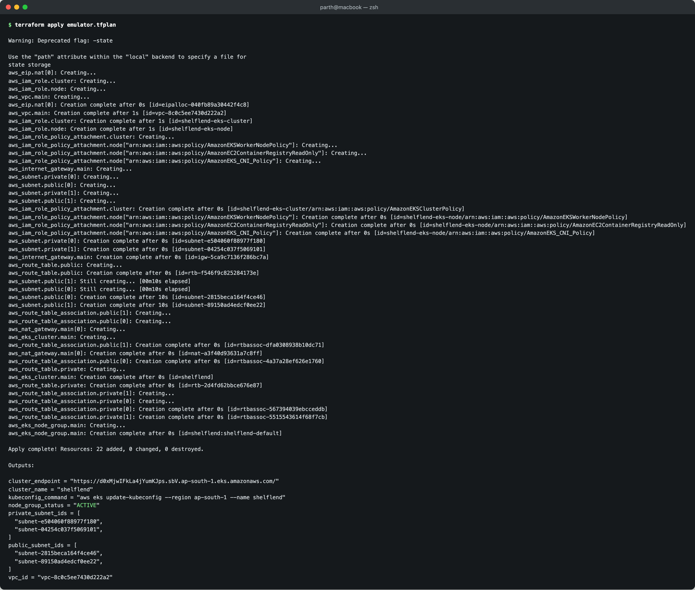 |
| **VPC, subnets, NAT, EKS via the AWS API (emulator)** | **`terraform destroy`: 22 destroyed, nothing left** |
| 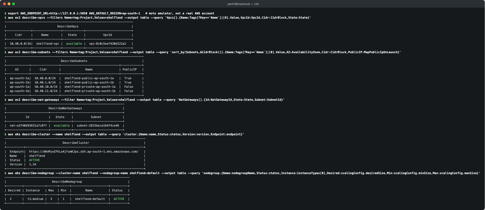 | 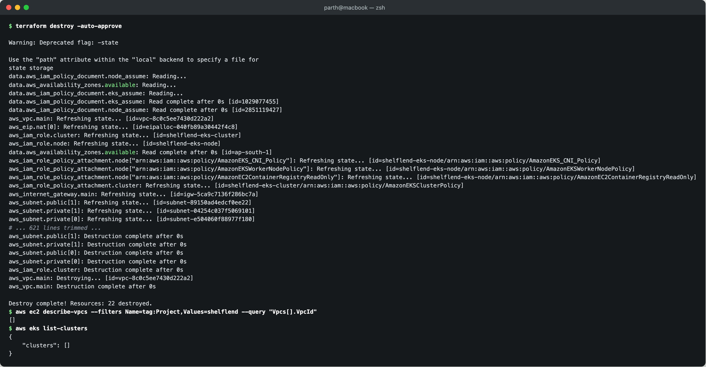 |

## M8: Kubernetes + Helm + Argo CD

**Chart** [helm/shelflend](helm/shelflend): backend Deployment + ClusterIP Service (startup/liveness on `/health`,
readiness on `/ready`, `maxUnavailable: 0`, config/secret checksums), frontend Deployment (**2 replicas**) +
ClusterIP, Postgres StatefulSet + headless Service + PVC, Ingress (`/api`, `/docs` Prefix and
`/openapi.json` ImplementationSpecific → backend; `/` → frontend), **HPA 2–6 @ 60% CPU** (so backend ≥ 2),
PDBs, ConfigMap/Secret, and behind `monitoring.enabled` a ServiceMonitor, PrometheusRule and Grafana dashboard.
Guard rails: `required` image tags (no deploy without a SHA); every pod runs `runAsNonRoot`, read-only root FS,
`seccompProfile: RuntimeDefault`, `allowPrivilegeEscalation: false` and drops all capabilities;
[k8s/namespace.yaml](k8s/namespace.yaml) enforces the **restricted** Pod Security Standard.

```bash
kind create cluster --name shelflend --config k8s/kind-cluster.yaml
kubectl apply -f https://raw.githubusercontent.com/kubernetes/ingress-nginx/controller-v1.15.1/deploy/static/provider/kind/deploy.yaml
helm upgrade --install metrics-server metrics-server/metrics-server -n kube-system --set 'args={--kubelet-insecure-tls}'
kubectl apply -f k8s/namespace.yaml

# production namespace: GitOps
kubectl -n shelflend create secret generic shelflend-db --from-literal=password="$(openssl rand -base64 24)"
helm upgrade --install argocd argo/argo-cd --version 10.10.5 -n argocd --create-namespace -f gitops/argocd-values.yaml
kubectl apply -f gitops/argocd-application.yaml

# staging namespace: plain Helm (shows in `helm list`)
helm upgrade --install shelflend ./helm/shelflend -n shelflend-staging -f helm/shelflend/values-staging.yaml \
  --set backend.image.tag=<sha> --set frontend.image.tag=<sha> --wait
```

Hostnames: add `127.0.0.1 shelflend.local grafana.shelflend.local prometheus.shelflend.local argocd.shelflend.local`
to `/etc/hosts`, or use `curl -H 'Host: shelflend.local' http://127.0.0.1/…`.

| `helm upgrade --install` + `helm list -A` | `kubectl get pods,svc,ingress,hpa,pdb` |
|---|---|
| 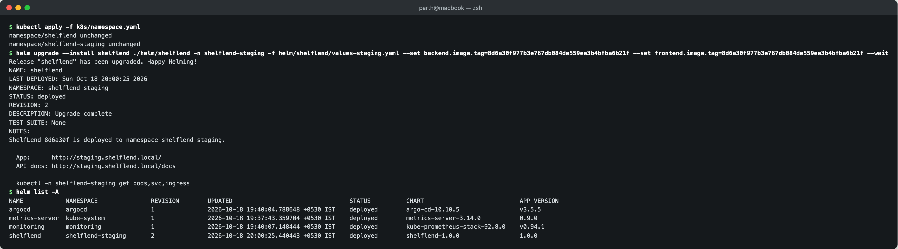 | 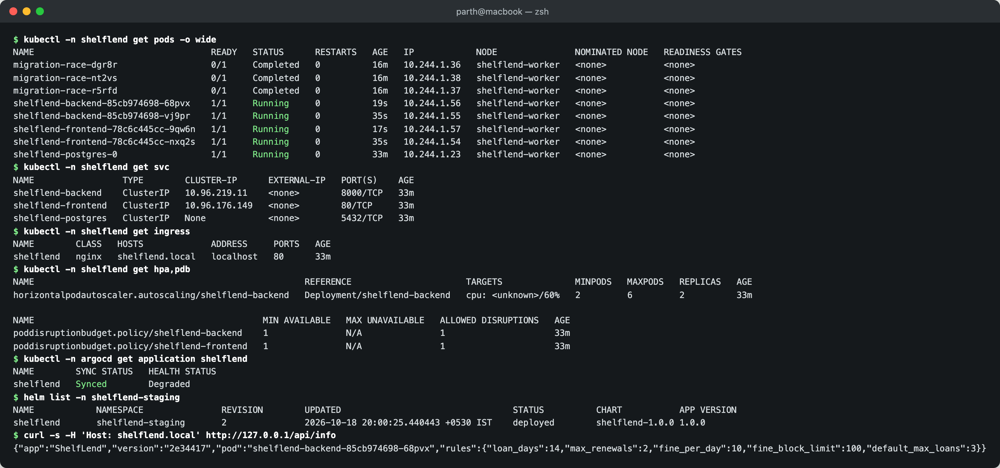 |

App through the Ingress hostname (`http://shelflend.local`) and the same data in Postgres:

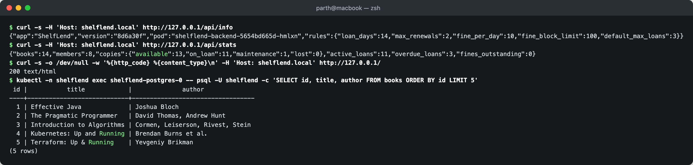

**GitOps.** Argo CD tracks `helm/shelflend` on `main` with [gitops/values-gitops.yaml](gitops/values-gitops.yaml),
auto-sync with prune + self-heal, and ignores Deployment `/spec/replicas` because the HPA owns it.

| Argo CD: Synced / Healthy at the pipeline's promote commit | History: every deploy by the automated sync policy |
|---|---|
| 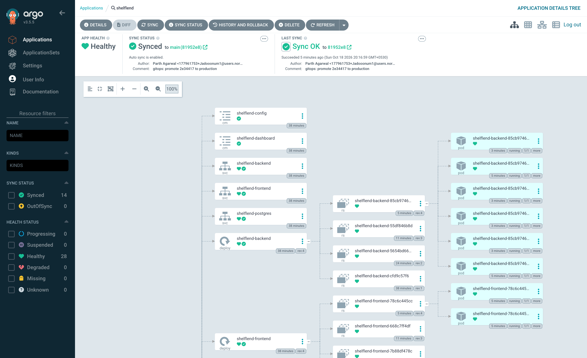 | 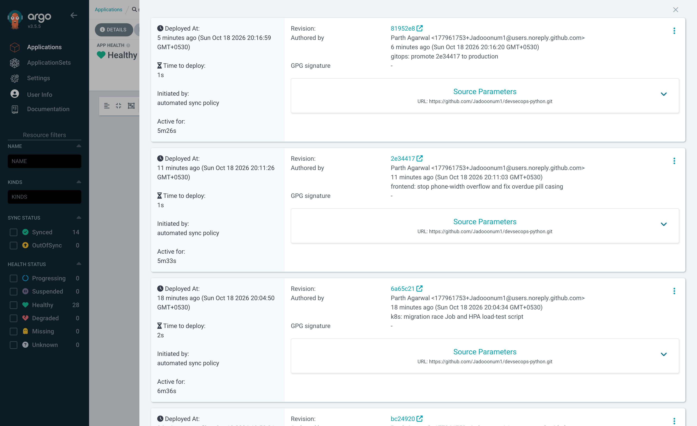 |

**Migration race.** [k8s/migration-race-job.yaml](k8s/migration-race-job.yaml) runs 3 pods doing `alembic upgrade head`
at once on an empty DB: one applies 0001/0002, the other two wait on the advisory lock and find the schema at head.

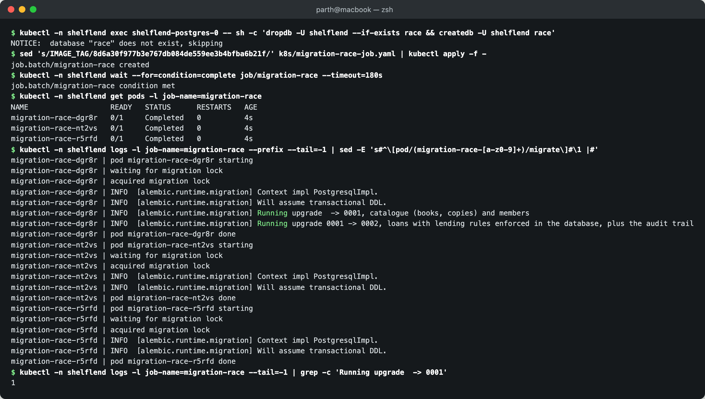

**HPA under load.** [scripts/load-test.sh](scripts/load-test.sh) sends 16 concurrent curl workers through the Ingress
for 4 minutes. The backend went **2 → 6 replicas about 45 s in** (CPU 396% of a 60% target) and was **back to 2
about 110 s after the load stopped** (60 s stabilisation window). During the run Prometheus showed 6/6 targets UP.

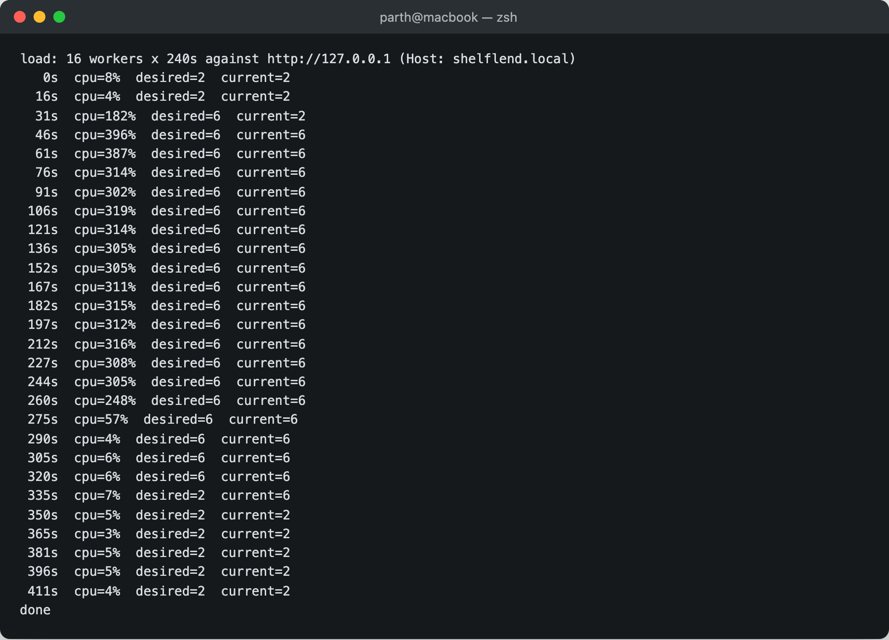

## M9: Observability

* **`/metrics`**: `prometheus-fastapi-instrumentator` with latency buckets from 5 ms (`http_requests_total`,
  `http_request_duration_seconds`), plus **business gauges** read from Postgres at scrape time
  ([app/metrics.py](backend/app/metrics.py)): `shelflend_loans_active`, `shelflend_loans_overdue`,
  `shelflend_copies{status}`, `shelflend_fines_outstanding_rupees`, `shelflend_db_up`. Being DB-backed, every
  replica reports the same truth.
* **Prometheus** ([monitoring/kube-prometheus-stack-values.yaml](monitoring/kube-prometheus-stack-values.yaml)):
  `serviceMonitorSelectorNilUsesHelmValues: false` (and the rule/pod equivalents) so the app's ServiceMonitor and
  rules are picked up; kind's unreachable control-plane targets are disabled.
* **Alerts** ([prometheusrule.yaml](helm/shelflend/templates/prometheusrule.yaml)): BackendDown, 5xx > 5%,
  p95 > 500 ms, and the business alert **overdue loans > 5**.
* **Grafana**: admin password from a Secret created at install time (never in Git); the dashboard
  ([dashboards/shelflend.json](helm/shelflend/dashboards/shelflend.json)) ships in the chart and is loaded by the
  sidecar: request rate, status classes (not stacked), p50/p95/p99, requests per pod, copies by status, fines.

| `curl /metrics` | Prometheus targets: all backend pods UP |
|---|---|
| 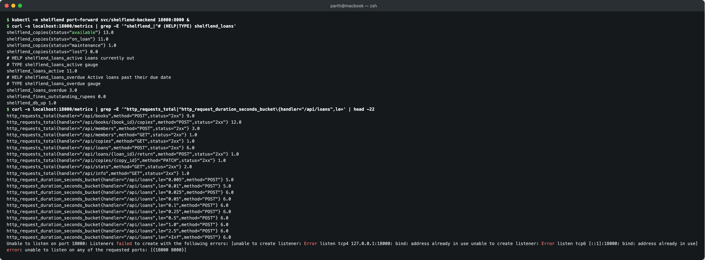 | 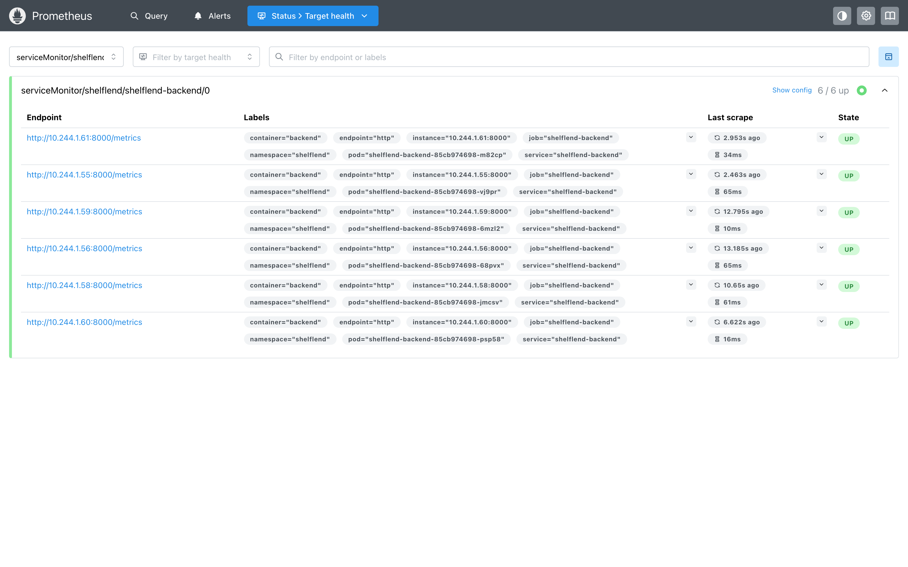 |

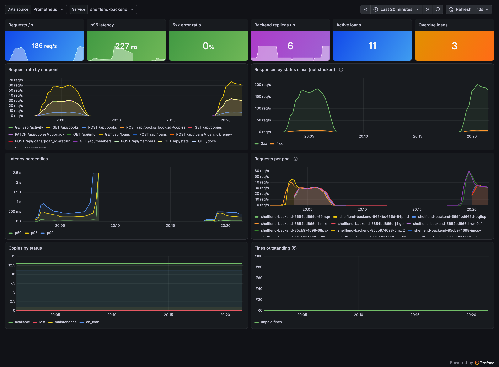

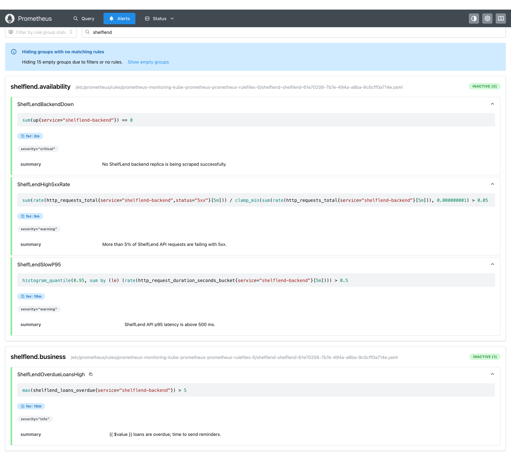

## Troubleshooting labs

Each lab was applied broken, diagnosed and fixed live; the full command output is in the screenshots.

| Lab | Symptom | Diagnosis | Fix | Evidence |
|---|---|---|---|---|
| [01-broken-image](troubleshooting/01-broken-image.yaml) | `ImagePullBackOff` | `describe pod` events: `ErrImagePull` on a misspelt image | `kubectl set image` | [png](screenshots/lab1-image.png) |
| [02-broken-service](troubleshooting/02-broken-service.yaml) | pods Ready, Service unreachable | EndpointSlice has no endpoints; selector `broken-servcie` ≠ pod label | `kubectl patch svc` → curl returns HTTP 200 | [png](screenshots/lab2-service.png) |
| [03-broken-probe](troubleshooting/03-broken-probe.yaml) | Running but `0/1` | `Readiness probe failed … :80 connection refused` (nginx listens on 8080) | patch probe port | [png](screenshots/lab3-probe.png) |

## Engineering findings

Real problems hit while building this, and how each was fixed:

| Problem | Cause | Fix |
|---|---|---|
| First Argo CD sync crash-looped with `exec format error` | CI built amd64 only; this Mac's kind nodes are arm64 | build linux/amd64 + linux/arm64 with buildx; scan each platform; push the manifest list |
| Trivy failed the backend image (7 HIGH) | old Starlette pin, plus pip's vendored urllib3/msgpack and setuptools in the runtime | upgrade pins; multi-stage Dockerfile with no pip/setuptools in the runtime |
| Grafana latency panel errored, 5xx stat said "No data" | my dashboard generator mangled `histogram_quantile`; a ratio with no 5xx series is empty, not 0 | rebuilt the queries; `(… or vector(0))` numerator |
| Phone layout overflowed at 390 px | CSS grid items default to `min-width: auto` | `.shell > * { min-width: 0 }`; verified `scrollWidth == 390` on every page |
| DB password would change on every Argo CD sync | Argo CD renders Helm without `lookup()`, so a generated secret is regenerated | GitOps values use `existingSecret`, created once at bootstrap |
| `helm list` is empty for the GitOps namespace | Argo CD applies manifests and creates no Helm release | a Helm-installed `shelflend-staging` namespace |
| `ubuntu-latest` was due to switch to Ubuntu 26 on 19 Oct 2026 | runner image migration annotation | pinned `ubuntu-24.04` |
| `/metrics` not reachable through the Ingress | by design only `/api`, `/docs`, `/openapi.json` go to the backend | Prometheus scrapes the Service directly; manual curl via `kubectl port-forward` |
| zsh broke `"$i:latest"` and unquoted lists | `:l` is a zsh modifier; zsh doesn't word-split `$VAR` | `"${i}:latest"`, arrays |

Two corrections to my own records: the commit message of `security: … clear HIGH CVEs in backend` lists 6 CVEs but omits
the 7th finding (msgpack GHSA-6v7p-g79w-8964). Also, my first local capture of the Trivy "blocked" run printed the exit
status of an `echo` instead of Trivy's. Both Trivy evidence files were re-captured from a rebuild of the pre-fix commit
(`7edeb82`), and they show Trivy's real exit codes (1, then 0).

## Known issues and limitations

* **Terraform ran on an emulator, not real AWS** (see [M7](#m7-terraform)): no AWS Console screenshots; the AWS CLI output
  from moto stands in. The EKS cluster was never actually deployed to.
* **Kubernetes ran on a local kind cluster** (1 control-plane + 1 worker). The chart is EKS-ready but untested there.
* **Single Postgres replica** with a PVC and no backups/HA; production would use RDS or an operator.
* **No authentication**: the desk UI and API are open; a real deployment needs staff login and roles.
* **Demo data is backdated with SQL** ([scripts/backdate-loans.sql](scripts/backdate-loans.sql)) to show overdue fines; the API
  deliberately has no way to backdate loans.
* **Business gauges query the DB on every scrape** (fine at this size; at scale they would move to a recording job).
* **ingress-nginx** is in maintenance-only retirement upstream; the Gateway API would be the long-term choice.
* **The video has no voice-over**; each scene has an on-screen caption, and the 5-minute pipeline wait is sped up 6×.

## M10: Presentation and demo

* [demo/ShelfLend-demo.mp4](demo/ShelfLend-demo.mp4): 12 min 41 s, 1280×720, in the order SUBMISSION.md asks for:
  1. **Slides** (14 slides: what was built, architecture)
  2. **Codebase** on GitHub: repo tree, `main.py` borrow logic, `models.py` constraints, `alembic/env.py`, the workflow, the Helm chart
  3. **CI/CD**: a real UI fix committed and pushed → [run 39137097931](https://github.com/Jadooonum1/devsecops-python/actions/runs/39137097931) from queued to all 11 jobs green → GHCR shows the new SHA
  4. **Terraform**: init, plan (22 to add), apply, the created VPC/subnets/NAT/EKS (emulator), destroy
  5. **Argo CD**: app Synced/Healthy at the pipeline's promote commit, automated sync history
  6. **Kubernetes**: pods/services/ingress/HPA, then the app through the Ingress showing build `2e34417` and the fixed UI
  7. **Prometheus**: ShelfLend targets UP (6/6 under load) and the alert rules
  8. **Grafana**: live dashboard during a load test
* [demo/ShelfLend-presentation.pptx](demo/ShelfLend-presentation.pptx) / [.pdf](demo/ShelfLend-presentation.pdf): overview,
  lending rules, tech stack, architecture diagram, three-layer rule enforcement, CI/CD flow, the CVE story,
  Terraform VPC diagram, Kubernetes + GitOps loop, HPA load-test chart, observability, key learnings, limitations.

## Submission checklist

| Rubric item | Evidence |
|---|---|
| Public GitHub repo | <https://github.com/Jadooonum1/devsecops-python> |
| `docker compose up --build` starts all 3 services | [M4](#m4-docker) |
| ≥ 4 REST endpoints (GET/POST/PUT/DELETE), `/health` | [Endpoints](#endpoints) |
| Alembic migration present | [backend/alembic/versions/](backend/alembic/versions) |
| pytest passes, ≥ 5 tests, test DB, conftest/pytest.ini | [M2](#m2-testing) (32 tests) |
| `.gitignore`, ≥ 10 meaningful commits | [M3](#m3-git-and-github) |
| Multi-stage frontend, non-root images | [M4](#m4-docker) |
| Workflow on push to main, pytest gate, frontend build, both images | [M5](#m5-cicd-pipeline) |
| Images in GHCR tagged with the commit SHA | [M5](#m5-cicd-pipeline) |
| Trivy on both images, fails on HIGH/CRITICAL, CVE explained | [M6](#m6-devsecops) |
| No secrets committed | Gitleaks over full history in CI |
| Terraform: valid HCL, init, plan, VPC + 2 public subnets, EKS + node group, destroy, tfvars.example | [M7](#m7-terraform) (emulator, see note) |
| `k8s/namespace.yaml`, Helm chart, `helm upgrade --install`, `helm list` | [M8](#m8-kubernetes--helm--argo-cd) |
| ≥ 2 replicas, ClusterIP Services, Ingress `/` and `/api`, pods Running | [M8](#m8-kubernetes--helm--argo-cd) |
| App through the Ingress hostname | [M1](#m1-application) screenshots (URL bar shows `shelflend.local`) |
| `/metrics`, Prometheus Targets UP, Grafana panels | [M9](#m9-observability) |
| README, video, slides in `demo/` | this file, [demo/](demo) |
